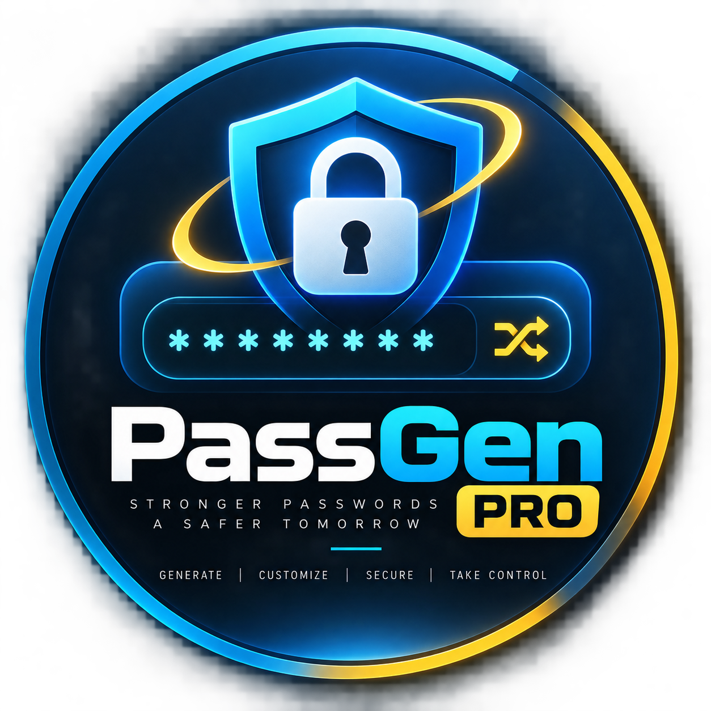

  

# PassGen Pro

An advanced, client‑side password generator built with vanilla HTML, CSS, and JavaScript.

## Features

- **Configurable length** (6 – 40 characters) with a live slider.
- **Character set selection**: lowercase, uppercase, digits, symbols, and custom characters.
- **Pronounceable passwords** for easier memorisation.
- **Enforce inclusion** of at least one character from each selected set.
- **Separator insertion** (custom separator and interval).
- **Bulk generation** – generate multiple passwords at once.
- **Password history** with pinning, export, and clear‑history actions.
- **Auto‑copy** on generation, plus manual copy buttons.
- **Entropy & strength meter** visual feedback.
- **Responsive dark UI** with gradient background and optional theme toggle.
- **Keyboard shortcuts** (`Ctrl+Enter` to generate, `Ctrl+C` to copy).

## How to Use

1. Open `index.html` in a browser.
2. Adjust the options in the **Options Panel**:
   - Move the **Length** slider.
   - Check/uncheck character sets.
   - Provide custom symbols if desired.
   - Enable **Pronounceable**, **Exclude similar**, **Enforce all sets**, etc.
   - Set a **Separator** and interval if you want grouped output.
   - Choose the **Count** to generate multiple passwords.
3. Click **Generate** (or press `Ctrl+Enter`).
4. The generated password appears at the top. Use the copy button to copy it to the clipboard.
5. History shows previously generated passwords; you can pin, export, or clear them.

## Development

The entire application lives in a single `index.html` file for ease of distribution. No build step or external dependencies are required—just open the file in a modern browser.

If you wish to modify or extend the generator:
- Edit the JavaScript inside the `<script>` tag.
- Adjust styles in the `<style>` block.
- The code is written in plain ES6 JavaScript; you can replace the random generator with `crypto.getRandomValues` for cryptographically‑secure passwords.

## License

MIT License – feel free to use, modify, and distribute.

Made with ❤️ by Chie
